


🇬🇧 [English](README.md) · 🇪🇸 **Español**

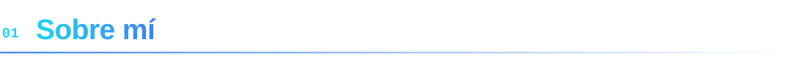


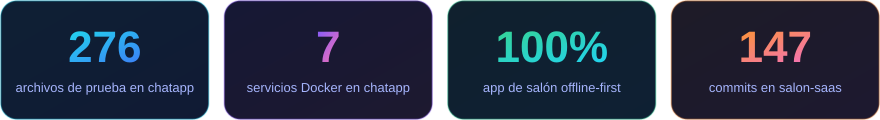

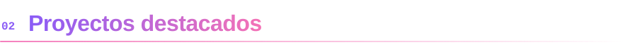

<a href="https://github.com/Ranta2025/chatapp"></a>
<a href="https://github.com/Ranta2025/salon-saas"></a>
<a href="https://github.com/Ranta2025/gestion-salon"></a>
<a href="https://github.com/Ranta2025/portfolio"></a>

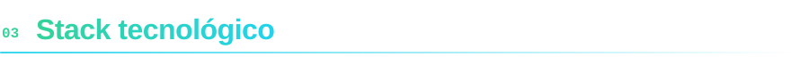

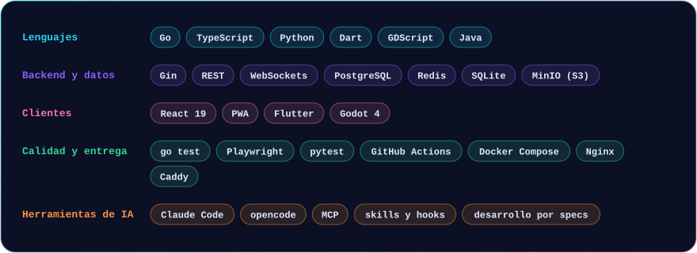

Los casos de estudio completos y mi CV (EN/ES) están en mi **[portfolio](https://rafael-tanda.vercel.app)** · Idiomas: español (nativo), inglés (B1)

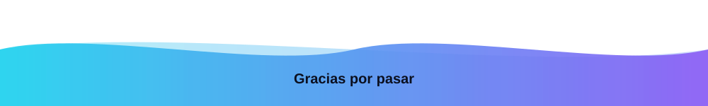

