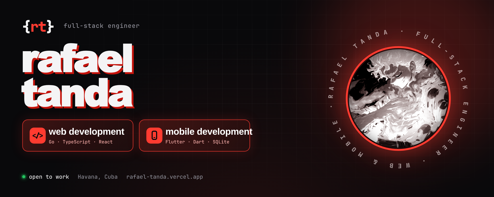
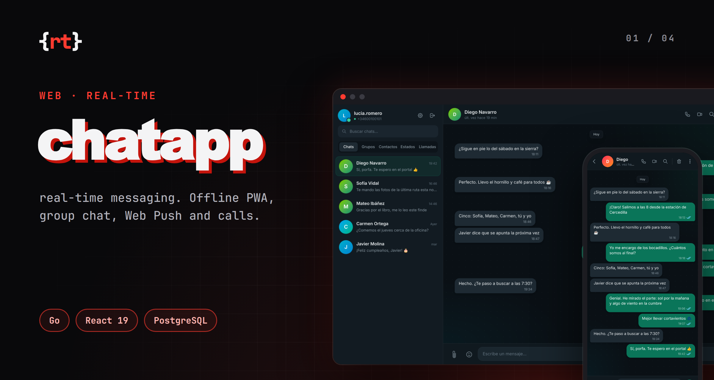
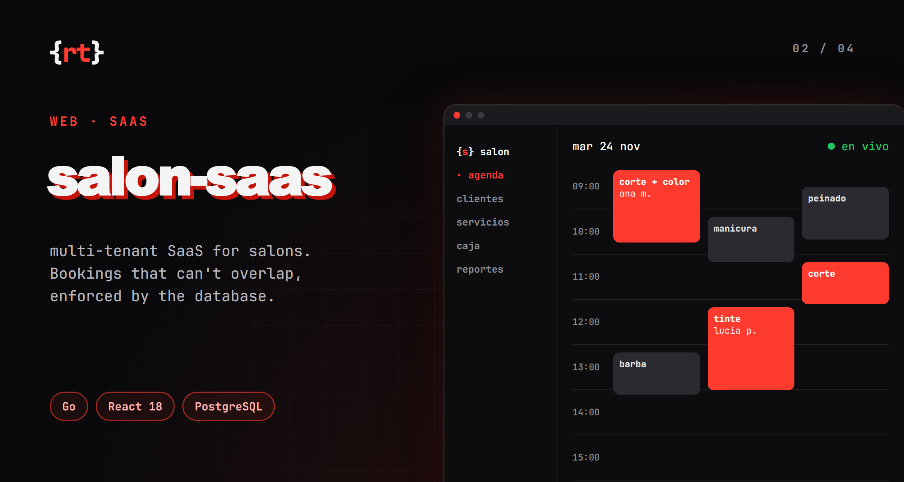
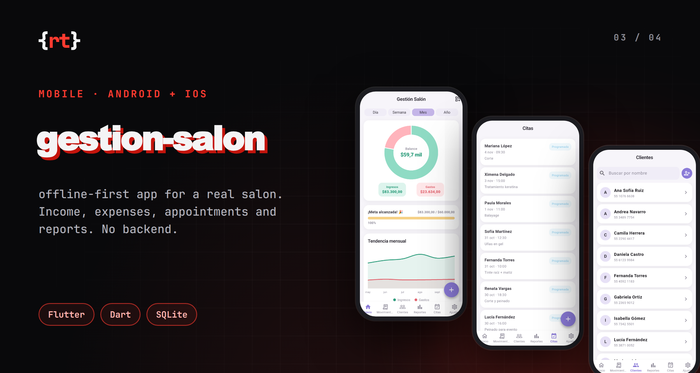
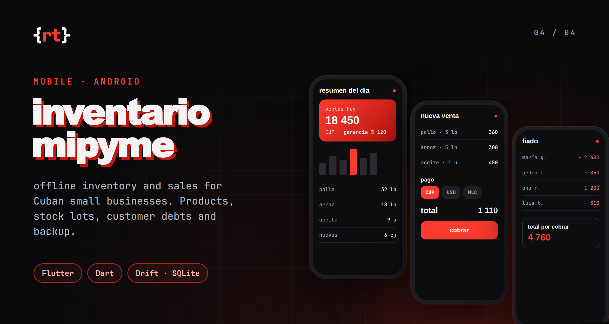

🇬🇧 **English** · 🇪🇸 [Español](README.es.md)

Full-stack engineer from Havana, Cuba. I ship **web and mobile products end to end** for real clients: Go and TypeScript backends, React apps, Flutter mobile apps. I work with AI coding agents in the loop, and every change passes tests and my own review.

## 🌐 Web development

*Backend, APIs, real-time and PWAs.*

<table><tr><td width="50%"></td><td width="50%"></td></tr></table>

## 📱 Mobile development

*Offline-first apps for Android and iOS.*

<table><tr><td width="50%"></td><td width="50%"> 🔒 Private repository — available on request</td></tr></table>

## 🧰 Stack

**Web** &nbsp;         

**Mobile** &nbsp;      

**Tools & more** &nbsp;      

---

Case studies and my CV (EN/ES) are on my **[portfolio](https://rafael-tanda.vercel.app)**. Languages: Spanish (native), English (B1).

